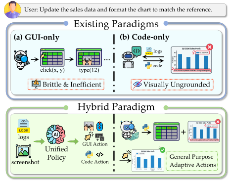
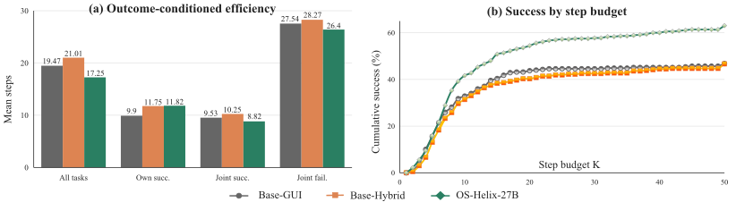
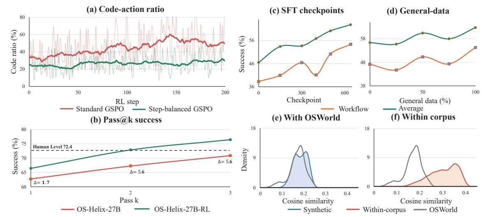
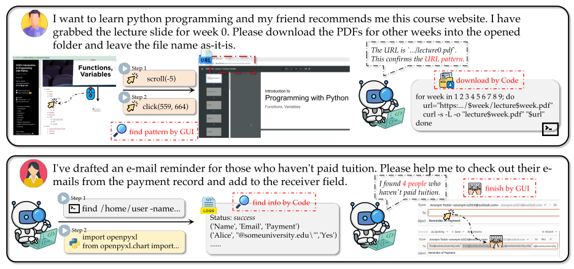
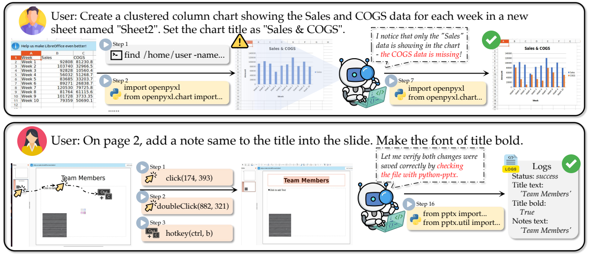
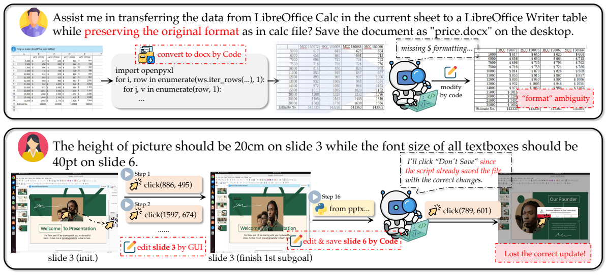

<div align="center">

# OS-Helix
### Unifying GUI Interaction and Code Execution in Native Computer-Using Agents

[](https://os-copilot.github.io/OS-Helix)


**Bowen Yang<sup>1,2,*</sup>, Kaiming Jin<sup>3,*</sup>, Zichen Ding<sup>2,*</sup>, Zhenyu Wu<sup>4</sup>, Zehao Li<sup>1</sup>, Zhoumianze Liu<sup>5</sup>, Kanzhi Cheng<sup>6</sup>, Fangzhi Xu<sup>7</sup>, Yanan Sun<sup>2</sup>, Qiushi Sun<sup>8,†</sup>, Yu Qiao<sup>2,†</sup>**

<sup>1</sup>University of Science and Technology of China · <sup>2</sup>Shanghai AI Laboratory · <sup>3</sup>National University of Singapore · <sup>4</sup>Shanghai Jiao Tong University · <sup>5</sup>Fudan University · <sup>6</sup>Nanjing University · <sup>7</sup>Xi’an Jiaotong University · <sup>8</sup>The University of Hong Kong

<sup>*</sup>Equal contribution · <sup>†</sup>Corresponding authors

</div>

> **Code and Data: Coming Soon.** This repository currently introduces the paper. Training and evaluation code, data, and model artifacts are planned for release.

| OSWorld-Verified | WindowsAgentArena | OSWorld Pass@3 |
| :---: | :---: | :---: |
| **66.44%** | **63.87%** | **76.44%** |

## Overview

Real desktop work moves between visible interfaces and the files, scripts, and system state behind them. GUI interaction offers broad access to applications and their rendered state; code enables precise, efficient operations on structured artifacts. **OS-Helix learns to coordinate both within one native computer-using policy.**

Tool access alone does not establish this coordination. In our Qwen3-VL-32B-Instruct diagnostic, simply exposing code lowers OSWorld success from 34.17% to 32.68%. We instead train the decision of *when to use the GUI, when to execute code, and when to switch back to verify the result*. The same policy observes screenshots and selects GUI actions, Python/Bash execution, or task termination in a unified action space.



*Complementary interfaces to the same desktop state. GUI observations and code execution support one another throughout a task.*

Our pipeline connects four ingredients: **application–artifact composition** for reproducible desktop states; **environment-grounded, independently verifiable tasks**; **supervised fine-tuning (SFT)** on filtered hybrid trajectories; and **online reinforcement learning (RL) with Step-balanced GSPO**. The data infrastructure spans 45 application entries and produces approximately 9K instructions, 83K unfiltered desktop SFT samples, and 31K successful filtered samples.

On OSWorld-Verified, OS-Helix-27B and OS-Helix-35B-A3B improve over their matched hybrid backbones by **35.0% and 33.7% relatively**. OS-Helix-27B-RL reaches **66.44%**, a 42.9% relative improvement over its hybrid backbone, and transfers to WindowsAgentArena at **63.87%** without Windows-specific training data.

## OS-Helix Framework


*From executable environments to verifiable tasks, hybrid demonstrations, and online policy improvement.*

### 1. Application–Artifact Composition

We factor a desktop environment into versioned applications and authentic artifacts. An application–artifact compatibility graph connects file types to applications that can open and manipulate them: a presentation, for example, can instantiate a task in LibreOffice Impress or WPS Presentation. Version, launch, and initialization configurations make these Ubuntu states reproducible. The inventory covers office work, programming, graphics, media, science, knowledge work, finance, and OS operations.

### 2. Environment-Grounded Task Synthesis

An Exploration Agent inspects the actual application and artifact before proposing a user instruction and observable success conditions. A global application memory tracks previously exercised functionality to encourage coverage. Once accepted, the instruction is frozen and passed to an independent Evaluator Agent; the evaluator checks the desired terminal state without prescribing a GUI or code solution.

An *everything-is-a-file* abstraction turns terminal conditions into inspectable representations where possible. Rule-based checks handle files and command-line state; visual or hybrid checks cover outcomes that require rendered appearance. Instructions are reviewed for feasibility and clarity, evaluators must compile and reject the initial state, and near-duplicate tasks are removed. Cross-application synthesis is supported as a limited prototype, with broader scaling left for future work.

### 3. Hybrid SFT Cold Start

Claude Sonnet 4.6 generates demonstrations with computer-use and Bash tools. We normalize trajectories to the unified action schema and reject unsuccessful, malformed, or low-quality samples. One epoch of SFT combines approximately **31K successful desktop samples** with **40K general-purpose multimodal samples**, establishing tool semantics, task-state tracking, and a usable GUI/code routing policy.

### 4. Online RL with Step-balanced GSPO

Starting from OS-Helix-27B, we run 1,000 online RL training steps in live Ubuntu sandboxes using rule-based terminal rewards. Cross-node environment management, asynchronous rollouts, success-rate-aware task sampling, and bounded visual-context segmentation make desktop interaction practical at training time.

Code actions are typically much longer than clicks or keystrokes. Standard Group Sequence Policy Optimization (GSPO) lets these token-heavy actions dominate the sample-level importance ratio. **Step-balanced GSPO first averages log-importance weights within each action, then averages across action steps with equal GUI/code weights.** This changes the importance-ratio aggregation while retaining GSPO’s objective and clipping structure. It removes token-count weighting at that level; it does not guarantee equal parameter-gradient norms or optimal routing.

## Main Experiments

We evaluate OS-Helix on **OSWorld-Verified** and **WindowsAgentArena**. The two benchmarks measure desktop task success on Ubuntu and cross-platform transfer to Windows.

### OSWorld-Verified

SFT raises the 27B hybrid backbone from **46.50% to 62.75%** (+16.25 percentage points) and the 35B-A3B backbone from **42.84% to 57.27%** (+14.43 points). The largest SFT gains occur in Office and multi-application Workflow tasks. RL increases the 27B average to **66.44%**, with its additional gains concentrated in Professional, OS, and Daily tasks. Office and Workflow do not improve further over SFT.

**Table 1 · OSWorld-Verified: full main comparison**

| Model / method | Setting | OS | Office | Daily | Prof. | Work. | Avg. |
| --- | --- | --- | --- | --- | --- | --- | --- |
| **Agentic frameworks · published context** |  |  |  |  |  |  |  |
| UiPath w/ GPT-5 | GUI | 73.91 | 49.52 | 62.12 | 71.43 | 37.30 | 53.69 |
| CoAct-1 w/ GPT-5 | Hybrid | 75.00 | 62.93 | 57.94 | 71.43 | 47.87 | 59.93 |
| GTA1 w/ GPT-5 | GUI | 79.17 | 63.91 | 62.56 | 79.59 | 50.91 | 63.41 |
| Agent S3 w/ GPT-5 | Hybrid | 77.50 | 66.46 | 61.23 | 69.80 | 51.37 | 62.63 |
| OS-Symphony w/ GPT-5 | Hybrid | 79.17 | 65.73 | 67.76 | 69.23 | 57.98 | 65.84 |
| **General and specialist models · published context** |  |  |  |  |  |  |  |
| Claude Sonnet 4.5 | GUI | 70.83 | 72.59 | 61.35 | 63.27 | 49.54 | 62.88 |
| OpenCUA-72B | GUI | 61.13 | 44.73 | 49.95 | 72.58 | 22.16 | 44.91 |
| UI-TARS | GUI | 41.67 | 50.42 | 55.69 | 51.02 | 14.66 | 41.85 |
| UI-TARS-2 | GUI | 41.67 | 61.11 | 62.12 | 61.22 | 34.13 | 53.10 |
| DeepMiner-Mano-72B | GUI | 66.67 | 63.22 | 52.51 | 83.67 | 24.41 | 53.91 |
| EvoCUA-32B | GUI | 78.26 | 59.79 | 64.55 | 81.63 | 27.89 | 56.73 |
| EvoCUA-1.5-32B | GUI | — | — | — | — | — | 63.20 |
| Kimi K2.5 | GUI | 73.91 | 69.20 | 66.42 | 73.47 | 46.11 | 63.34 |
| Kimi K2.6 | GUI | 79.17 | 80.03 | 77.11 | 81.63 | 54.97 | 73.07 |
| Qwen3.7-Plus | GUI | 79.17 | 82.91 | 74.03 | 73.47 | 59.25 | 73.33 |
| **Matched backbone baselines · reproduced** |  |  |  |  |  |  |  |
| Qwen3.5-27B † | GUI | 66.67 | 39.60 | 57.50 | 52.00 | 36.06 | 46.61 |
| Qwen3.5-27B † | Hybrid | 66.67 | 39.26 | 58.79 | 49.96 | 38.29 | 46.50 |
| Qwen3.5-35B-A3B † | GUI | 37.50 | 46.92 | 44.57 | 38.77 | 25.65 | 39.20 |
| Qwen3.5-35B-A3B † | Hybrid | 69.57 | 40.94 | 46.21 | 52.22 | 31.01 | 42.84 |
| **OS-Helix · native hybrid policies** |  |  |  |  |  |  |  |
| **OS-Helix-35B-A3B** | **Hybrid** | **60.87 (↓8.7)** | **70.00 (↑29.1)** | **52.19 (↑6.0)** | **56.31 (↑4.1)** | **45.14 (↑14.1)** | **57.27 (↑14.4)** |
| **OS-Helix-27B** | **Hybrid** | **75.00 (↑8.3)** | **72.60 (↑33.3)** | **58.32 (↓0.5)** | **56.49 (↑6.5)** | **54.28 (↑16.0)** | **62.75 (↑16.3)** |
| **OS-Helix-27B-RL** | **Hybrid** | **82.61 (↑15.9)** | **69.14 (↑29.9)** | **65.01 (↑6.2)** | **79.59 (↑29.6)** | **53.32 (↑15.0)** | **66.44 (↑19.9)** |

† Reproduced in the paper; other baselines are taken from the official leaderboard as reported in the manuscript. Office: Calc, Impress, Writer. Daily: Chrome, Thunderbird, VLC. Prof.: GIMP, VS Code. Work.: multi-application workflows. Published baseline budgets and harnesses may differ. Green ↑ and red ↓ annotations reproduce absolute percentage-point changes from the paper relative to each model’s matched Hybrid backbone.

### WindowsAgentArena

Ubuntu-trained OS-Helix transfers to Windows with **Python-only code actions** and a prompt adaptation, without Windows-specific training. The RL model reaches **63.87%**: +7.46 points over the matched hybrid backbone and +5.92 over SFT. The detailed domain results below extend the main comparison with the breakdown from Appendix E.1.

**Tables 2 & 12 · WindowsAgentArena: overall and domain results**

| Model / method | Setting | Steps | Office | Web | Sys. | Code | Media | Util. | Avg. |
| --- | --- | --- | --- | --- | --- | --- | --- | --- | --- |
| **Agentic frameworks · published context** |  |  |  |  |  |  |  |  |  |
| Agent S3 w/ GPT-5 | Hybrid | 50 | — | — | — | — | — | — | 54.10 |
| Agent S3 w/ GPT-5 | Hybrid | 100 | — | — | — | — | — | — | 56.60 |
| OS-Symphony w/ GPT-5-Mini | Hybrid | 50 | 42.86 | 73.00 | 79.17 | 68.42 | 48.66 | 66.67 | 62.15 |
| OS-Symphony w/ GPT-5 | Hybrid | 50 | 54.76 | 73.00 | 75.00 | 42.11 | 70.09 | 75.00 | 63.45 |
| **General and specialist models · published context** |  |  |  |  |  |  |  |  |  |
| Qwen3-VL-32B-Thinking | GUI | 50 | 17.07 | 56.33 | 68.18 | 64.29 | 29.33 | 63.64 | 45.95 |
| UI-TARS-1.5-7B | GUI | 50 | — | — | — | — | — | — | 42.10 |
| UI-TARS-2 | GUI | 50 | — | — | — | — | — | — | 50.60 |
| UI-Mate-27B | GUI | — | — | — | — | — | — | — | 66.20 |
| EvoCUA-32B | GUI | — | — | — | — | — | — | — | 56.48 |
| EvoCUA-1.5-32B | GUI | — | — | — | — | — | — | — | 62.10 |
| **Matched backbones and OS-Helix** |  |  |  |  |  |  |  |  |  |
| Qwen3.5-27B † | GUI | 50 | 30.23 | 36.33 | 62.50 | 50.00 | 28.41 | 50.00 | 40.82 |
| Qwen3.5-27B † | Hybrid | 50 | 41.86 | 63.00 | 83.33 | 54.17 | 42.70 | 66.67 | 56.41 |
| **OS-Helix-27B** | **Hybrid** | **50** | **39.53** | **66.33** | **91.67** | **54.17** | **39.75** | **75.00** | **57.95** |
| **OS-Helix-27B-RL** | **Hybrid** | **50** | **39.53** | **76.33** | **75.00** | **73.91** | **65.81** | **75.00** | **63.87** |

† Reproduced in the paper. Office: Writer and Calc; Web: Edge and Chrome; Sys.: Windows system tasks; Code: VS Code; Media: VLC; Util.: Windows utilities. — means not reported. The 100-step Agent S3 result is shown with its different budget explicitly labeled.

## Ablation Studies

Controlled ablations separate the effects of data quality, training stages, the RL objective, and hybrid supervision. Unless noted otherwise, these experiments use Qwen3.5-27B and the OSWorld evaluation harness from the main experiments.

### Data Robustness

On the same 800 synthesized tasks, trajectories from both teachers improve over the 46.50% hybrid backbone, while the stronger teacher yields a larger gain. Removing all samples from the nine OSWorld application domains retains **62.31%** success versus 62.75% with the full desktop pool, supporting transfer beyond those application domains.

**Table 3a · Trajectory teacher, same 800 tasks**

| Teacher | Success (%) | Gain vs. backbone (pp) |
| --- | --- | --- |
| Kimi K2.5 | 54.03 | +7.53 |
| Claude Sonnet 4.6 | 58.77 | +12.27 |

**Table 3b · Removal of OSWorld application domains**

| Desktop data | Desktop samples | Success (%) |
| --- | --- | --- |
| Full synthesized pool | ~31K | 62.75 |
| Nine application domains removed | ~17K | 62.31 |

### Training Stages and RL Objective

**SFT provides the main improvement.** RL alone adds only 1.70 points, while SFT followed by RL achieves the best result. With initialization, data, sampling, reward, and optimization budget held fixed, standard GSPO degrades performance and shifts toward code-heavy behavior; Step-balanced GSPO improves success while preserving a code-action fraction close to the SFT policy.

**Table 4a · Training-stage attribution**

| Variant | SFT | RL | Success (%) |
| --- | --- | --- | --- |
| Hybrid backbone | No | No | 46.50 |
| RL only | No | Yes | 48.20 |
| SFT only | Yes | No | 62.75 |
| **SFT → RL** | **Yes** | **Yes** | **66.44** |

**Table 4b · Controlled RL-objective comparison**

| RL objective | Success (%) | Change vs. SFT (pp) | Code actions (%) |
| --- | --- | --- | --- |
| Standard GSPO | 60.47 | −2.28 | 40.0 |
| **Step-balanced GSPO** | **66.44** | **+3.69** | **26.1** |

The SFT starting point has a 27.9% code-action rate. Code-action rate is a behavioral diagnostic, not a target to maximize.

### Code Access versus Learned Coordination

The same OS-Helix checkpoint retains useful GUI competence without code (52.13%) and gains **10.62 points** when code is available. At a fixed 10K-sample SFT budget with code enabled for both variants at inference, hybrid demonstrations outperform GUI-only demonstrations by **3.05 points**. These comparisons separate learning to coordinate tools from merely exposing an extra tool.

**Table 5a · Inference-time code access**

| Policy | Code access | Success (%) | Code actions (%) |
| --- | --- | --- | --- |
| Qwen3.5-27B | No | 42.59 | — |
| **OS-Helix-27B** | **No** | **52.13** | **—** |
| **OS-Helix-27B** | **Yes** | **62.75** | **27.9** |

This is the dedicated code-access ablation reported in Table 5a; its Qwen3.5 no-code score is distinct from the GUI baseline in Table 1.

**Table 5b · SFT modality at a fixed sample budget**

| SFT data | Samples | Code access | Success (%) | Code actions (%) |
| --- | --- | --- | --- | --- |
| GUI only | 10K | Yes | 57.56 | 11.7 |
| Hybrid GUI/code | 10K | Yes | 60.61 | 37.1 |

## Discussion

### Accuracy and Interaction Efficiency

OS-Helix-27B completes tasks with fewer interactions while covering more successful tasks under small step budgets. The analysis includes all tasks, each policy’s own successes, and outcome-matched subsets where all compared policies either succeed or fail. Matching outcomes helps distinguish shorter execution from simply solving an easier subset.



*Figure 3 · Efficiency on OSWorld. The analysis compares the GUI backbone, hybrid backbone, and OS-Helix-27B.*

### Why Step Balance Matters

GUI clicks and keystrokes are short, while code actions can contain many more tokens. Standard GSPO therefore gives long code steps disproportionate influence over the sample-level importance ratio. Figure 4(a) shows the resulting behavioral drift: under matched training conditions, standard GSPO increasingly favors code, whereas Step-balanced GSPO keeps the code-action fraction lower and more stable over the shared observed horizon. In the controlled ablation, standard GSPO reaches 60.47% success with 40.0% code actions; step-balanced training reaches **66.44%** with 26.1% code actions, close to the SFT policy’s 27.9%. Figure 4(b) further shows broader repeated-sampling coverage: RL raises Pass@3 from 70.88% to **76.44%** (+5.56 points; paired-bootstrap 95% confidence interval [2.24, 8.97]). Together, these results support balancing action steps during optimization rather than rewarding a shift toward more code use.



*Figure 4 · Training dynamics and coverage. Standard GSPO drifts toward code-intensive actions, while step-balanced training remains more stable over the observed horizon.*

### Training Scaling and Data Distributions

Figure 4(c) tracks Workflow and overall success across checkpoints from the first SFT epoch; Figure 4(d) holds desktop supervision fixed and varies the proportion of the 40K general-purpose multimodal pool. Both studies show overall gains as supervision grows, supporting complementary contributions from hybrid desktop trajectories and general-purpose data. Panels (e)–(f) compare instruction-embedding similarity distributions within the synthesized corpus and against OSWorld. Together with the domain-removal ablation, these distributions provide evidence consistent with transferable desktop-task structure; instruction similarity alone does not establish the absence of every form of overlap.

### Additional Experiments

The following diagnostics use **Qwen3-VL-32B backbones and SFT only**, with the same data recipe. They probe transfer across model families and the role of supervision and context; they do not measure the contribution of the Qwen3.5-based online RL stage.

### Backbone Replacement

For the Instruct backbone, code access alone reduces success from 34.17% to 32.68%, whereas hybrid SFT raises it to **50.56%**. For the Thinking backbone, SFT improves the matched hybrid baseline from 42.88% to **51.67%**. Gains span several domains, although the Thinking model’s Professional score decreases, showing that capability changes remain model-dependent.

**Table 14 · OSWorld backbone replacement, 50 steps**

| Model | Setting | OS | Office | Daily | Prof. | Work. | Avg. |
| --- | --- | --- | --- | --- | --- | --- | --- |
| Qwen3-VL-32B-Instruct † | GUI | 41.67 | 31.54 | 51.23 | 44.90 | 15.57 | 34.17 |
| Qwen3-VL-32B-Instruct † | Hybrid | 50.00 | 33.25 | 39.31 | 38.78 | 18.78 | 32.68 |
| Qwen3-VL-32B-Thinking † | GUI | 58.33 | 35.84 | 54.44 | 55.10 | 18.71 | 39.08 |
| Qwen3-VL-32B-Thinking † | Hybrid | 62.50 | 40.97 | 49.81 | 53.85 | 27.95 | 42.88 |
| **OS-Helix-32B** | **Hybrid** | **66.67 (↑16.7)** | **52.91 (↑19.7)** | **56.14 (↑16.8)** | **51.02 (↑12.2)** | **38.54 (↑19.8)** | **50.56 (↑17.9)** |
| **OS-Helix-32B-Thinking** | **Hybrid** | **70.83 (↑8.3)** | **52.91 (↑11.9)** | **61.21 (↑11.4)** | **51.02 (↓2.8)** | **37.35 (↑9.4)** | **51.67 (↑8.8)** |

† Reproduced baselines. These are Qwen3-VL diagnostics, separate from the main Qwen3.5 model family. Green ↑ and red ↓ show absolute percentage-point changes relative to the corresponding Instruct or Thinking Hybrid backbone.

### Grounding Ability

Isolated visual grounding does not improve with this recipe: the trained 32B model scores lower than the reproduced backbone on both grounding benchmarks. The end-to-end gains therefore coexist with a grounding trade-off and are consistent with better task-state management and modality routing, rather than stronger pixel localization alone.

**Table 13 · Grounding benchmarks**

| Model | OSWorld-G | ScreenSpot-V2 |
| --- | --- | --- |
| Qwen3-VL-32B-Instruct (reported) | 65.10 | 95.80 |
| Qwen3-VL-32B-Instruct (reproduced) | 61.35 | 95.05 |
| **OS-Helix-32B** | **57.21** | **93.47** |

### Reasoning Context and Data Filtering

Removing reasoning traces from training or inference lowers success by roughly 12.8 points. Removing only historical reasoning from training is less damaging, but still costs 7.34 points. Adding rejected failure samples reduces performance to 47.06%. These experiments support the roles of structured context and filtered demonstrations in maintaining coherent multi-step execution.

**Table 15 · Training recipe and inference context**

| Training recipe | Inference context | OS | Office | Daily | Prof. | Work. | Avg. |
| --- | --- | --- | --- | --- | --- | --- | --- |
| Normal | Normal | 66.67 | 52.91 | 56.14 | 51.02 | 38.54 | 50.56 |
| Normal | No reasoning (CoT) | 54.17 (↓12.5) | 28.98 (↓23.9) | 53.58 (↓2.6) | 38.77 (↓12.3) | 31.43 (↓7.1) | 37.82 (↓12.7) |
| No reasoning (CoT) | Normal | 50.00 (↓16.7) | 35.55 (↓17.4) | 46.99 (↓9.2) | 38.77 (↓12.3) | 28.87 (↓9.7) | 37.74 (↓12.8) |
| No historical reasoning | Normal | 60.87 (↓5.8) | 43.51 (↓9.4) | 54.19 (↓2.0) | 39.80 (↓11.2) | 31.30 (↓7.2) | 43.22 (↓7.3) |
| Add failure data | Normal | 54.17 (↓12.5) | 48.67 (↓4.2) | 54.80 (↓1.3) | 50.28 (↓0.7) | 35.16 (↓3.4) | 47.06 (↓3.5) |

CoT means chain-of-thought reasoning text. “No historical reasoning” removes historical CoT from training samples while retaining current-step reasoning and action text. Green ↑ and red ↓ show absolute percentage-point changes relative to the Normal training / Normal inference recipe.

## Case Studies and Behavioral Analysis

### GUI and Code as Complementary Tools



*Representative hybrid workflows from the paper. Each modality supplies task-relevant information or operations to the other.*

The synthesis case studies make verification concrete. An office/code task starts from a vehicle spreadsheet, asks for efficiency labels, and then requires a runnable Python audit script. Its evaluator separately checks spreadsheet contents, data-derived script logic, and executed output. A media task transfers persistent configuration between recording and video-editing tools. Both illustrate component-wise terminal evaluation rather than prescribing one action path.

### Cross-Modal Verification and Repair

In a spreadsheet-chart example, code creates a chart, the GUI reveals a missing data series, and code repairs it. In the reverse direction, the agent edits a slide through the GUI and inspects the saved file with code to verify notes and title formatting. These traces show switching for verification and repair, beyond selecting one tool at the start of a task.



*Figure 7 · Successful cross-modality solve-and-verify cases.*

### Failure Modes at the GUI–Code Boundary

Hybrid execution still requires consistent visual and persistent state. One failure loses row shading during a Calc-to-Writer conversion and misdiagnoses the visual mismatch as missing currency symbols. Another saves a code-side presentation edit without incorporating an unsaved GUI edit, then discards the earlier change. These cases motivate evaluators that cover visual intent and policies that reconcile in-memory and on-disk state before switching modalities.



*Figure 8 · Failures involving visual equivalence and cross-modality state handoffs.*

A manual audit of **30 representative Workflow trajectories** finds grounded GUI/code handoffs in 27, including cross-modal verification or repair in 22. Outcomes are 21 successes, four partial successes, and five failures. This is process-level evidence from a selected subset; the frequencies are not estimates for the entire benchmark, and they do not establish optimal routing.

## Limitations and Future Work

The current environment inventory cannot capture the diversity of real machines, private artifacts, versions, and user configurations. Rule-based verification can be brittle, while visual evaluators may miss fine details; the RL reward therefore uses rule-based checks only. Broader evaluator validation, repair, and robustness to reward hacking remain important.

Online RL is currently demonstrated on the dense 27B model under limited compute. Scaling training and extending stable optimization to mixture-of-experts models remain open. Future directions include wider Windows and macOS coverage, stronger cross-application synthesis, self-improvement through agent-generated trajectories, and benchmarks that jointly assess correctness, interaction efficiency, modality choice, and safety.

## Related Projects

[OSReward](https://os-copilot.github.io/OSReward-Home/) · [OS-Symphony](https://os-copilot.github.io/OS-Symphony/) · [OS-Sentinel](https://qiushisun.github.io/OS-Sentinel-Home/) · [ScienceBoard](https://qiushisun.github.io/ScienceBoard-Home/) · [OS-Genesis](https://qiushisun.github.io/OS-Genesis-Home/) · [OS-Atlas](https://osatlas.github.io/) · [OpenMobile-2](https://os-copilot.github.io/OpenMobile2-Home/) · [OpenMobile](https://njucckevin.github.io/openmobile/) · [SeeClick](https://aclanthology.org/2024.acl-long.505)

## Cite Us

```bibtex
@misc{yang2026oshelix,
  title = {OS-Helix: Unifying GUI Interaction and Code Execution in Native Computer-Using Agents},
  author = {Bowen Yang and Kaiming Jin and Zichen Ding and Zhenyu Wu and Zehao Li and Zhoumianze Liu and Kanzhi Cheng and Fangzhi Xu and Yanan Sun and Qiushi Sun and Yu Qiao},
  year = {2026},
  url = {https://github.com/OS-Copilot/OS-Helix}
}
```
